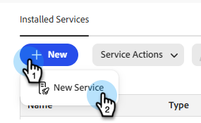
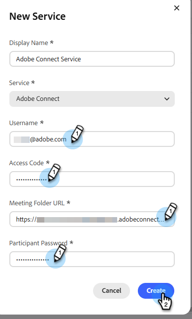

# Agregar [!DNL Adobe Connect] como servicio [!DNL LaunchPoint] {#add-adobe-connect-as-a-launchpoint-service}

Marketo administra el registro y la asistencia a [!DNL Adobe Connect] seminarios web.

>[!PREREQUISITES]
>
>* Se requiere una suscripción existente a [!DNL Adobe Connect] y derechos de administración. Tenga a mano los siguientes detalles: nombre de usuario, contraseña, contraseña del participante y URL de la carpeta de reunión.

>[!NOTE]
>
>* **Se requieren permisos de administrador**
>* [!DNL Adobe Connect On Site] no es compatible actualmente.

1. En Mi Marketo, haz clic en **[!UICONTROL Administrador]**.

1. En **[!UICONTROL Integración]**, seleccione **[!UICONTROL LaunchPoint]**.

   

1. Haga clic en **[!UICONTROL Nuevo]** y seleccione **[!UICONTROL Nuevo servicio]**.

   

1. Escriba un **[!UICONTROL Nombre para mostrar]**. En el menú desplegable **[!UICONTROL Servicio]**, seleccione **[!UICONTROL Adobe Connect]**.

   

1. Escriba su **[!UICONTROL nombre de usuario]**, **[!UICONTROL código de acceso]**, **[!UICONTROL dirección URL de la carpeta de reuniones]** y **[!UICONTROL contraseña de participante]**, y después haga clic en **[!UICONTROL Crear]**.

   

   >[!TIP]
   >
   >Cuando crea la contraseña del participante, el valor que elija se incluye en una cadena de consulta cuando se envían los vínculos para el evento. Se recomienda hacerlo más fácil de usar.

   >[!NOTE]
   >
   >Después de iniciar sesión en su cuenta de [!DNL Adobe Connect], seleccione la ficha **[!UICONTROL Seminarios]**. Sin profundizar en ningún seminario específico, copie la dirección URL de la barra del explorador en la configuración de **[!UICONTROL URL de la carpeta de reuniones]**.

El servicio [!DNL Adobe Connect] se ha sincronizado con Marketo Engage.

>[!MORELIKETHIS]
>
>Aprenda a [crear un evento con [!DNL Adobe Connect]](/help/marketo/product-docs/demand-generation/events/create-an-event/create-an-event-with-adobe-connect.md){target="_blank"}.
