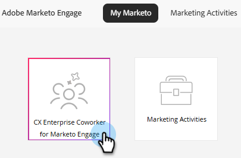
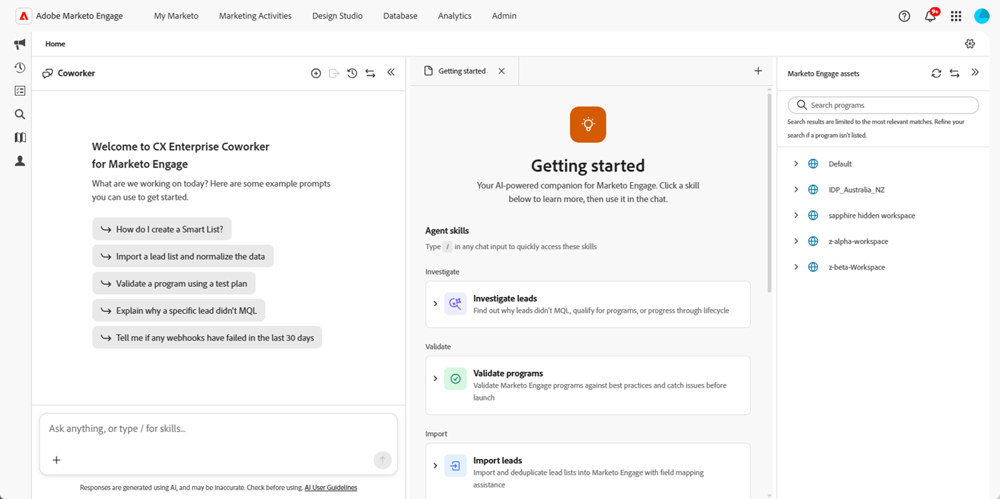

# Información general sobre CX Enterprise Coworker para Marketo Engage {#overview}

CX Enterprise Coworker para Marketo Engage proporciona habilidades de agente diseñadas para automatizar funciones de marketing importantes pero que llevan mucho tiempo.

>[!AVAILABILITY]
>
>Esta función está disponible para todas las suscripciones. Si no ve el mosaico de CX Enterprise Coworker for Marketo Engage en la pantalla de Mi Marketo, póngase en contacto con su administrador de cuentas. También debe aceptar los términos de la [generación principal de IA y los términos complementarios](https://www.adobe.com/legal/terms/enterprise-licensing/genai-ww.html){target="_blank"}.

>[!IMPORTANT]
>
>* Una vez habilitada la suscripción de CX Enterprise Coworker para Marketo Engage, debe realizar [algunos pasos de configuración](/help/marketo/product-docs/coworker-for-marketo/settings-setup.md){target="_blank"} para garantizar que los usuarios deseados tengan acceso.
>
>* Revise el ámbito de datos, los controles de control y las consideraciones PII en la [hoja de información de datos](/help/marketo/product-docs/coworker-for-marketo/data-information.md){target="_blank"} de CX Enterprise Coworker for Marketo Engage.

## Acceso {#access}

En la pantalla de Mi Marketo, haga clic en el mosaico **CX Enterprise Coworker for Marketo Engage**.

Escriba la solicitud en el campo de solicitud, seleccione una de las aptitudes de agente o pruebe con una de las solicitudes de ejemplo.

## Habilidades {#skills}

La consola central incluye un conjunto cada vez mayor de habilidades de agente disponibles para ayudarle con diversas tareas. Cada aptitud es un asistente de IA creado específicamente con el que interactúa a través del lenguaje natural para completar una tarea específica.

### Planificar campañas {#plan-campaigns}

Convierta un informe de campaña en un plan de implementación estructurado para Marketo Engage. La aptitud de las campañas de Plan describe la estructura del programa, la lógica de audiencia, los correos electrónicos, las campañas inteligentes, los tokens, los informes y las comprobaciones previas a la activación. Más información sobre la [aptitud para planificar campañas](/help/marketo/product-docs/coworker-for-marketo/skills/plan-campaigns.md){target="_blank"}.

### Generar programas {#build-programs}

Describa una campaña de marketing en un lenguaje sencillo y CX Enterprise Coworker para Marketo Engage crea la estructura del programa, con marcadores de posición de recursos y programación. Más información sobre la [aptitud para generar programas](/help/marketo/product-docs/coworker-for-marketo/skills/build-programs.md){target="_blank"}.

### Investigar posibles clientes {#investigate-leads}

Averigüe por qué una persona o posible cliente específico no alcanzó un hito (como MQL, calificación de programas o una campaña) y obtenga una explicación en lenguaje sencillo de lo que sucedió. Más información sobre la [aptitud para investigar posibles clientes](/help/marketo/product-docs/coworker-for-marketo/skills/investigate-leads.md){target="_blank"}.

### Conocimiento del producto {#product-knowledge}

El conocimiento del producto le permite acceder a petición a la experiencia de Marketo sin abandonar la plataforma. Haga una pregunta en lenguaje sencillo y CX Enterprise Coworker para Marketo Engage se basa en la documentación oficial de Adobe para responderla. Más información sobre la [aptitud para el conocimiento del producto](/help/marketo/product-docs/coworker-for-marketo/skills/product-knowledge.md){target="_blank"}.

### Validar programas {#validate-programs}

Validar programas comprueba automáticamente la configuración en función de las prácticas recomendadas de Marketo y muestra los problemas antes del inicio. Más información sobre la [aptitud para validar programas](/help/marketo/product-docs/coworker-for-marketo/skills/validate-programs.md){target="_blank"}.

### Importar posibles clientes {#import-leads}

Importe y deduplique listas de posibles clientes en la base de datos de Marketo Engage con ayuda de asignación de campos. Más información sobre la [habilidad Importar posibles clientes](/help/marketo/product-docs/coworker-for-marketo/skills/import-leads.md){target="_blank"}.

## Próximamente {#coming-soon}

Próximamente habrá más habilidades diseñadas para manejar el trabajo más repetitivo y que requiere más tiempo.

>[!MORELIKETHIS]
>
>[Marketo Engage MCP Server](https://experienceleague.adobe.com/docs/marketo-developer/marketo/mcp-server.html?lang=es){target="_blank"} actúa como un puente entre su asistente de IA y Marketo Engage.
